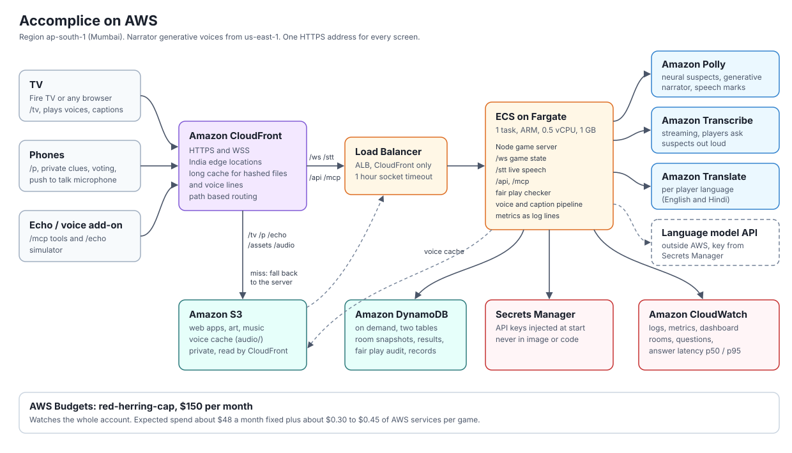

# Accomplice on AWS

Accomplice runs on AWS in Mumbai (ap-south-1), close to the players. A TV, up to six phones and an Echo all open one HTTPS address. That address serves the web apps, the game sockets, live speech and the voice add-on.



The whole stack is one AWS CDK app in [`infra/`](../infra). It is plain TypeScript, so every service and permission can be read in [`infra/lib/accomplice-stack.ts`](../infra/lib/accomplice-stack.ts).

## CloudFront status: designed, blocked by account verification

The stack was designed with **Amazon CloudFront** in front of everything: HTTPS, India edge locations, and S3 serving the web apps and voice cache. The first deploy failed with "Your account must be verified before you can add new CloudFront resources". New AWS accounts need a support case before they can use CloudFront, and we chose not to open one during the hackathon.

So CloudFront sits behind one flag, which is off by default:

| Mode | How phones get HTTPS | Static files | Deploy with |
|---|---|---|---|
| **Default (`cdn=false`)** | A Cloudflare quick tunnel runs inside the server container. It needs no account and no domain, and gives an `https://<random>.trycloudflare.com` address. | Served by the game server itself (`/tv /p /echo /assets /audio`). | `npm --prefix infra run deploy` |
| **CloudFront (`cdn=true`)** | CloudFront's own `https://<id>.cloudfront.net` address. | S3 behind CloudFront, falling back to the server on a miss. | `npm --prefix infra run deploy:cdn` (once the account is verified) |

Phones need HTTPS because browsers only allow the microphone on secure pages. The load balancer also serves the game over plain HTTP, which is fine for the TV and for typed questions.

The tunnel address changes every time the server container starts. The server writes the current address to the SSM parameter **`/accomplice/public-url`** and to the log (`public url: ...`). `infra/scripts/url.sh` prints it.

## How a game flows through AWS

1. The TV opens `https://<public url>/tv/`. The request goes through the tunnel to the game server on **ECS Fargate**, which serves the app.
2. The TV opens a WebSocket to `/ws`. The server creates a room and shows a QR code pointing at the same HTTPS address.
3. Phones scan the code and open `/p/?room=CODE`. Their game socket also goes to `/ws`.
4. A player holds the talk button and asks a suspect a question. The phone streams microphone audio over `/stt` to the server, and the server forwards it to **Amazon Transcribe** streaming. Words come back while the player is still talking.
5. The server writes the suspect's reply with a language model. Before anything is spoken, the fair play checker tests every claim in the reply against the case solution. A reply that would leak the secret is rewritten or deflected.
6. **Amazon Polly** turns the reply into speech in the suspect's voice. It also returns speech marks (the time of every word), so the TV can light up each caption word as it is spoken. Suspects use neural voices in Mumbai, which take about 0.6 s per line. The narrator uses generative voices in us-east-1, rendered while the lobby fills.
7. Each audio file is named by a hash of its text and voice, and the server copies it to **S3** under `audio/`. When a new container starts, it restores the cache from S3, so a line is never paid for twice.
8. A player who picked Hindi gets captions, clues and questions through **Amazon Translate**.
9. While the game runs, the server stores a snapshot of each room in **DynamoDB**, plus every fair play check and the final result. All-time counters are updated in place, so the stats page shows real numbers.
10. The server writes metrics as structured log lines. **CloudWatch** turns them into graphs for rooms, questions and answer latency.

## Services used and why

| Service | What it does here | Why this one |
|---|---|---|
| **Amazon Polly** | Voices for every suspect (neural, ap-south-1) and the narrator (generative, us-east-1). Speech marks give word timings for synced captions. | Many distinct voices and accents, fast neural voices in Mumbai, and word level timing from the same service that makes the audio. |
| **Amazon Transcribe** (streaming) | Turns the player's spoken question into text as they speak, over a WebSocket from the phone. | Partial results arrive while the player talks, so the suspect can start answering about a second after they stop. Supports English (India) and Hindi. |
| **Amazon Translate** | Per player language: captions, clues and questions in Hindi while the room plays in English. | Fast, cheap per character, and cached per line, so a phrase is translated only once. |
| **Amazon ECS on AWS Fargate** | Runs the Node game server container: one ARM task with 0.5 vCPU and 1 GB. The HTTPS tunnel runs in the same container. | The game depends on two long lived WebSockets (`/ws` and `/stt`). App Runner does not support WebSockets, so it was ruled out. Fargate needs no servers to manage and costs about $10.60 a month at this size. |
| **Application Load Balancer** | A stable plain HTTP address, health checks, and rolling deploys. Idle sockets stay open for up to an hour. With `cdn=true` it becomes CloudFront's origin and only accepts CloudFront. | ECS uses its health checks to replace a broken task, and it gives a fixed address that does not change on restart. |
| **Amazon S3** | Private bucket holding the voice cache (`audio/`). With `cdn=true` it also holds the web apps and art. | The voice cache outlives the container: a new task restores it from S3 instead of paying Polly again. |
| **Amazon DynamoDB** (on demand) | Game table: room snapshots (7 day TTL), fair play audit rows, game results and all-time counters. Records table: detective records for the voice add-on. | Pay per request, which costs nothing when idle. Single digit millisecond writes never slow the game, and the data survives restarts and deploys. |
| **AWS Secrets Manager** | Holds the language model API key and the optional ElevenLabs key. ECS injects them as environment variables when the task starts. | Keys never appear in the image, the template or git. One secret costs $0.40 a month. |
| **AWS Systems Manager Parameter Store** | `/accomplice/public-url` always holds the current game address. | The tunnel address changes on every start, so scripts and teammates read one fixed name instead. A standard parameter is free. |
| **Amazon CloudWatch** | Log group (14 day retention), metrics in the `Accomplice` namespace, and a dashboard named `Accomplice`. | Metrics are written as Embedded Metric Format log lines, so no metrics agent or extra API calls are needed. |
| **AWS Budgets** | The existing `red-herring-cap` budget ($150 a month) watches the account. | Hard guardrail for the hackathon. The stack itself is designed to use about a third of it. |
| **Amazon ECR, IAM, VPC** | ECR stores the container image (CDK pushes it). IAM roles follow least privilege. The VPC has two public subnets and no NAT gateway. | Leaving out the NAT gateway saves about $33 a month. The task gets a public IP for outbound calls (AWS APIs, the model API, the tunnel), and its security group only allows the load balancer in. |
| **Amazon CloudFront** (designed, off) | See the CloudFront section above. | Blocked by account verification. One flag enables it. |

Bedrock is not used. It is not available on this account, and the server runs with `MODEL_PROVIDER` unset.

### Least privilege

The game server's task role can only:

- `polly:SynthesizeSpeech`, `polly:DescribeVoices`
- `transcribe:StartStreamTranscription`, `transcribe:StartStreamTranscriptionWebSocket`
- `translate:TranslateText` (plus `comprehend:DetectDominantLanguage`, which Translate needs when the source language is automatic)
- `dynamodb:GetItem/PutItem/UpdateItem/Query` on the game table, and `GetItem/PutItem` on the records table
- `s3:GetObject/PutObject` on `audio/*` in its bucket, and `s3:ListBucket` limited to the `audio/` prefix
- `ssm:PutParameter` on `/accomplice/public-url` only

The execution role (used by ECS, not by the app) can read only the stack's own secret and write only to its own log group.

## The HTTPS tunnel

The container's entrypoint, `apps/server/docker-entrypoint.sh`, does the following when `TUNNEL=cloudflare` is set:

1. Starts `cloudflared tunnel --url http://127.0.0.1:8787 --no-autoupdate`.
2. Reads the `https://*.trycloudflare.com` address from cloudflared's log, exports it as `PUBLIC_URL`, and starts the server. QR codes and join links then use the HTTPS address.
3. If either process exits, the container exits and ECS starts a new one, which gets a new address.

The `cloudflared` binary is a pinned release (2026.9.3), downloaded from Cloudflare's GitHub releases and checked against its SHA256 at build time.

**Limits to know about.** A quick tunnel is meant for testing, has no uptime guarantee, and does not support server-sent events. For that reason, the MCP endpoint answers in plain JSON when `TUNNEL` is set (`enableJsonResponse`). Tool calls work normally, but server-pushed notifications on the standalone stream do not. The address changes whenever the task restarts, so after a deploy, rescan the QR code or run `url.sh`.

## What the server does on AWS

The AWS code lives in `apps/server/src/aws/`. Each piece is off unless its environment variable is set, so local play is unchanged.

| Env var (set by CDK) | File | Effect |
|---|---|---|
| `ACCOMPLICE_TABLE` | `store.ts` | Room snapshots (gzip, only written when the state changed), audit rows, results, and atomic all-time counters. Adds `GET /api/stats/all-time`. |
| `AUDIO_BUCKET` | `audio-sync.ts` | Watches the local voice cache and uploads new files to `s3://bucket/audio/`. On start it restores the cache from S3. |
| `EMF_METRICS=on` | `metrics.ts` | Metrics written as log lines: `ActiveRooms`, `RoomsInGame`, `ConnectedClients`, `Questions`, `AnswerLatencyMs`, `ReplyMs`, `FirstSentenceMs`, `CaughtViolations`, `Deflected`, `GamesStarted`, `GamesFinished`, `GameDurationMs`, `CaseGenMs`, `NarrationMs`. |
| `PUBLIC_URL_PARAM` | `index.ts` | Logs the public URL and writes it to SSM on start. |
| `TUNNEL=cloudflare` | `docker-entrypoint.sh`, `packages/mcp-game/src/handler.ts` | Starts the HTTPS tunnel and switches MCP replies to JSON. |
| `ACCOMPLICE_RECORDS=dynamodb`, `ACCOMPLICE_RECORDS_TABLE` | `packages/mcp-game` | Detective records for the voice add-on, stored by household. The table's partition key is `household`, which is the attribute name the package writes. |

Only a few existing files were touched, each with one line: `audit.ts` calls `onAudit()`, `server.ts` calls `initAws()`, and `mcp-game/src/handler.ts` sets `enableJsonResponse` from the environment.

Room snapshots are written today and can be read back with `getSnapshot(code)`. Rebuilding a live room from a snapshot needs a restore hook in `room.ts`, which has not been added yet. Until then, a deploy or restart in the middle of a game ends that game, but its audit rows and stats are kept. During a hackathon, deploy between games.

## Cost

Prices are on-demand list prices for ap-south-1 from the AWS Price List API (October 2026), in USD, for 730 hours a month.

### Fixed monthly cost (default mode, no CloudFront)

| Item | Calculation | Per month |
|---|---|---|
| Fargate task, ARM, 0.5 vCPU / 1 GB | 0.5 x $0.02383 + 1 x $0.00261 = $0.0145 per hour | $10.60 |
| Application Load Balancer | $0.0239 per hour, plus about 0.1 LCU | $18.00 |
| Public IPv4 addresses | 3 (load balancer in 2 zones, plus the task) x $0.005 per hour | $10.95 |
| CloudWatch custom metrics | about 13 metrics x $0.30 (the first 10 are free under the free tier) | $3.90 |
| CloudWatch dashboard | 1 dashboard (the first 3 are free under the free tier) | $3.00 |
| CloudWatch Logs | under 1 GB ingested at $0.67/GB, 14 day retention | $0.70 |
| Secrets Manager | 1 secret | $0.40 |
| ECR image storage | about 0.5 to 2 GB across deploys at $0.10/GB | $0.20 |
| S3, DynamoDB, SSM standard parameter | inside free tiers at hackathon scale | $0.20 |
| Data out to the internet (through the tunnel) | a few MB per game; the first 100 GB a month are free | $0.00 |
| Cloudflare quick tunnel | free | $0.00 |
| NAT gateway | not used | $0.00 |
| **Total fixed** | | **about $48** |

With `cdn=true`, CloudFront adds about $0 at this scale, because 1 TB and 10M requests a month are always free.

### Cost per game

Assumptions: 25 minutes, 4 players, 16 spoken questions, one case. Polly bills speech marks per character too, so each line counts twice.

| Item | Calculation | Per game |
|---|---|---|
| Polly neural (suspects) | 16 answers x 250 chars x 2 (audio + marks) = 8,000 chars x $16/M | $0.13 |
| Polly generative (narrator) | about 2,500 new chars x 2 x $30/M (fixed lines are cached in S3 and reused) | $0.15 |
| Transcribe streaming | 16 questions x 15 s minimum = 240 s x $0.0001667 | $0.04 |
| Translate (only when someone plays in Hindi) | about 8,000 chars x $15/M | $0.12 |
| DynamoDB, S3, data transfer | a few hundred writes, a few MB of audio | under $0.01 |
| **AWS total per game** | | **$0.32 in English, $0.44 with Hindi** |

The language model API is billed by its provider, outside AWS, and is not part of these numbers. Repeated narrator lines cost nothing after the first game, so later games cost closer to $0.20 to $0.30 each on AWS.

**Budget check:** about $48 fixed leaves about $100 of the $150 cap, which covers roughly 250 to 300 games a month. A busy judging week is far below that.

**Ways to spend less:** switch to 0.25 vCPU / 0.5 GB with `-c cpu=256 -c memoryMiB=512`, which saves about $5. Run `destroy` after judging, after which only the retained DynamoDB tables remain, at $0 when idle. If games run slow, go up with `-c cpu=1024 -c memoryMiB=2048` (+$10.60).

## Strands Agents: the house host

The Echo Show side of Accomplice has two ways to understand what someone says.

1. **An instant router** in the Echo page. Plain commands such as "start a new case", "ask the cook where she was at nine" or "I accuse the gardener" map straight to one MCP tool call. No model, no wait.
2. **The house host**, a [Strands Agents](https://strandsagents.com/) agent (TypeScript SDK `@strands-agents/sdk` 1.22) that runs inside the game server at `POST /api/host`. Anything the router cannot place goes here: "who was near the kitchen around nine?", "remind me what the butler said", "I think it was the cook with the port, are we sure?".

The house host is a real agent working across services. It connects to the game's own MCP server (`/mcp`, Streamable HTTP) with Strands' built in MCP client, discovers the eleven game tools, and decides which to call and in what order. For the kitchen question it typically lists the suspects, reads the board, then questions the cook, and answers in a sentence or two. The game server behind those tools does its own work: the case engine checks every answer, the suspects reply through the language model, and their voices come from Polly. The host also reads the add-on's `SKILL.md`, so it follows the same rules any agent host would: never reveal the solution, give one hint step at a time, and put every accusation to the room before it counts.

Why it matters for the game:
- **Voice first.** People do not speak in commands. The agent lets a family talk the way they talk, and the router keeps the common commands instant.
- **Memory.** Each household gets its own agent conversation, so "what did the butler say?" just works.
- **Safe by construction.** The agent can only act through the MCP tools. Accusations still need a spoken yes, and hints are rationed by the server, not by the prompt.
- **Visible.** The Echo page's developer drawer shows every step ("Strands agent called question_suspect(...)") with timings.

Model: the language model is called through one of Strands' built-in model providers (`HOST_MODEL` picks the model) with the same key the suspects use. Bedrock is not available on this account; Strands supports Bedrock first class, so switching is a one line change of model provider. The agent streams its words as Server-Sent Events, and the Echo starts speaking at the end of the first sentence. Measured from the utterance to the first spoken word: about 1 to 1.8 seconds when no tool is needed, and about 1.5 to 2.9 seconds when the agent calls tools, because it says a short lead in ("Let me ask the cook.") before working. The router path is instant.

Cost: the house host only runs for free form speech, about 3,500 input tokens and 100 output tokens per turn on a small model. It adds nothing to the AWS bill.

## Deploy and destroy

You need the AWS CLI logged in, Docker running, and Node 22 or newer. The web apps are built inside the Docker image.

```sh
# 1. one time: install the CDK app and bootstrap the account in ap-south-1
npm --prefix infra ci && npm --prefix infra run bootstrap

# 2. build and push the image, create everything (about 10 minutes)
npm --prefix infra run deploy

# 3. copy the API keys from apps/server/.env into Secrets Manager and restart the task
infra/scripts/put-secrets.sh
```

Then run `infra/scripts/url.sh --all` to print the HTTPS game address. Open `<url>/tv/` on the TV, and phones join from the QR code. Until step 3 has run, the game works in offline mode with canned suspect replies.

To preview changes without deploying: `npm --prefix infra run diff` (or `synth`). Once the account is verified for CloudFront: `npm --prefix infra run deploy:cdn`, which also needs pnpm to build the web apps for S3.

To destroy:

```sh
npm --prefix infra run destroy
```

This removes everything except the two DynamoDB tables, which are kept on purpose so game history survives. To delete them as well:
`aws dynamodb delete-table --region ap-south-1 --table-name <GameTableName>` (and the same for `<RecordsTableName>`, both from the stack outputs).

### Notes

- **Redeploys and keys.** The secret is created with empty values. Redeploying never overwrites keys set by `put-secrets.sh`, because the template value does not change.
- **No secrets in the image.** `.dockerignore` excludes every `.env` file. Keys reach the container only through Secrets Manager.
- **Rolling deploys.** ECS starts the new task, waits for `/api/health`, and only then stops the old one. If the new task fails its health check, the circuit breaker rolls back. Each new task gets a new tunnel address.
- **Dashboard.** CloudWatch, then Dashboards, then `Accomplice` (the link is in the `DashboardUrl` output). It shows rooms, questions, answer latency p50/p95, suspect reply time, fair play catches, CPU and memory, load balancer errors, and recent server warnings.
