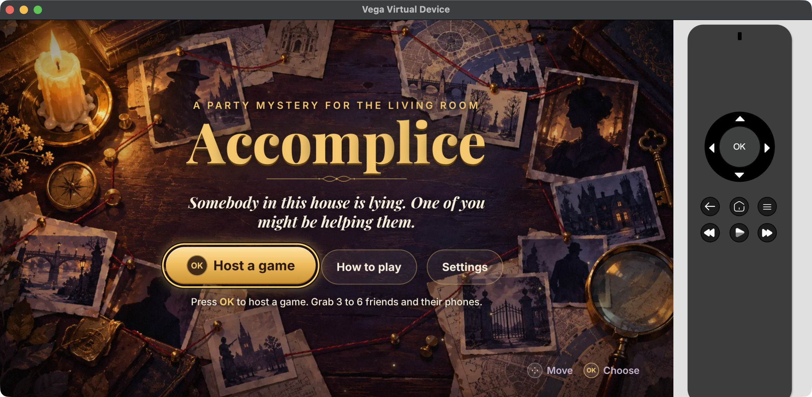
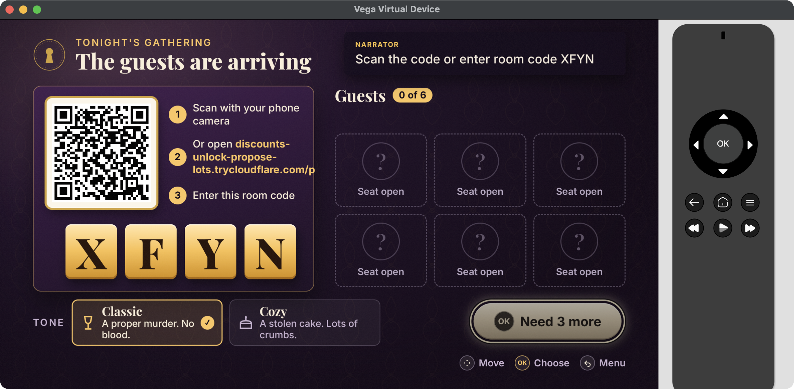

# Accomplice on Fire TV (Vega OS)

The Fire TV app is a small Vega OS app (`apps/vega`) that opens the game's TV stage in a full-screen WebView. The stage is served by the live game server, so every TV in a room stays in sync with the phones. If the server can't be reached, the app shows a bundled "We can't reach the game" page, and OK retries.

- Package id: `com.accomplice.tv`, component `com.accomplice.tv.main`
- Server: `http://Accomp-Alb16-mcZdJ1MHVPFR-1726733199.ap-south-1.elb.amazonaws.com/tv/?device=vega` (set in `apps/vega/src/config.ts`)
- Built with Vega SDK 0.24.12112 and Vega CLI 1.4.7, React Native 0.83 for Vega, `@amazon-devices/webview` 4





Both screenshots are from the Vega Virtual Device running the release package against the live server, taken on 23 October 2026.

## Packages

All packages are in `apps/vega/release/`. Checksums are in `apps/vega/release/SHA256SUMS.txt`.

| File | CPU | Build | Size |
|---|---|---|---|
| `accomplice_armv7_release.vpkg` | armv7 (most Fire TV sticks) | Release | 154,538 bytes |
| `accomplice_aarch64_release.vpkg` | aarch64 (Vega Virtual Device on Apple Silicon, 64-bit devices) | Release | 154,537 bytes |
| `accomplice_x86_64_release.vpkg` | x86_64 (Vega Virtual Device on Intel) | Release | 154,538 bytes |
| `accomplice_armv7_debug.vpkg` | armv7 | Debug | 457,943 bytes |
| `accomplice_aarch64_debug.vpkg` | aarch64 | Debug | 457,910 bytes |
| `accomplice_x86_64_debug.vpkg` | x86_64 | Debug | 457,666 bytes |

Use a Release package unless you need to debug. Only `accomplice_aarch64_release.vpkg` was run and measured; the armv7 and x86_64 packages were built from the same source but not run.

To rebuild (from `apps/vega`, with npm, since this folder is outside the pnpm workspace):

```sh
source ~/vega/env
npm install
npm run build:release   # build/<arch>-release/accomplice_<arch>.vpkg
npm run build:debug     # build/<arch>-debug/accomplice_<arch>.vpkg
```

Use the npm scripts, not a bare `vega build`. `vega build -b Release` on its own skipped the JavaScript bundle and produced a 5 KB package that can't run.

## Install and run

### One command

```sh
apps/vega/scripts/judge-run.sh                 # a device is already connected
START_VVD=1 apps/vega/scripts/judge-run.sh     # boot the Vega Virtual Device first
apps/vega/scripts/judge-run.sh apps/vega/release/accomplice_armv7_release.vpkg   # pick a package
```

The script waits for a device, picks the release package that matches the device's CPU, installs it, launches it, and retries if the device reports "offline".

### By hand on the Vega Virtual Device

```sh
source ~/vega/env
nohup vega virtual-device start --timeout 180 &
vega device list            # repeat until the virtual device is listed
vega run-app apps/vega/release/accomplice_aarch64_release.vpkg com.accomplice.tv.main
```

If `run-app` fails with "device offline", wait about 20 seconds and run it again. On an Intel Mac, use the x86_64 package.

### By hand on a Fire TV with Vega OS

1. Turn on developer mode on the device and connect it to the computer as the Vega SDK docs describe. Check it is visible with `vega device list`.
2. Install and launch:

```sh
vega device install-app -p apps/vega/release/accomplice_armv7_release.vpkg
vega device launch-app -a com.accomplice.tv.main
# or both at once:
vega run-app apps/vega/release/accomplice_armv7_release.vpkg com.accomplice.tv.main
```

Use the aarch64 package if `vega device list` reports an aarch64 device. This path was not tested, because no Fire TV hardware was available.

### Playing

Press OK on "Host a game". The TV shows a room code and a QR code. Phones join by scanning the code or by opening the address shown on the TV. Three to six players are needed to start.

## Plain HTTP and the WebView

The game server's load balancer serves plain HTTP. The Vega WebView blocks cleartext HTTP by default. The first build pointed at the server showed the offline page, even though `curl` from the device shell got a 200 from the same URL.

The fix is a manifest section that allows cleartext for this one host only:

```toml
[network-traffic-policy.cleartext]
allowed-domains = ["accomp-alb16-mczdj1mhvpfr-1726733199.ap-south-1.elb.amazonaws.com"]
```

This section is not in the public Vega docs as of SDK 0.24. The key names come from the manifest schema inside the device's package manager (`libvega_packagemanager_omnikit.so` lists `network-traffic-policy`, `cleartext`, `allowed-domains`, `blocked-domains`). The build's manifest check accepts it, and with it the app loads the live stage (screenshots above). If the server moves to HTTPS, delete the section. If the server's hostname changes, update both `src/config.ts` and this list.

## Performance on the Vega Virtual Device

Measured on 23 October 2026 with the aarch64 release package on the Vega Virtual Device (firmware `vvrp-tv-arm64-user OS 1.2 (TV Ship/102282480)`), on a MacBook with Apple Silicon running macOS 26, against the live server in AWS ap-south-1. This is an emulator on a laptop, so these numbers say little about how a Fire TV stick will perform.

| Metric | Median | Samples | Tool |
|---|---|---|---|
| Cold start: launch to first frame (TTFF) | 749 ms | 5 (622 to 1,029 ms) | KPI Visualizer, `cool-start-latency` |
| Cold start: launch to fully drawn (TTFD) | 1,452 ms | 5 (1,035 to 1,628 ms) | KPI Visualizer, `cool-start-latency` |
| JavaScript bundle load | 6.4 ms | 6 | KPI Visualizer |
| Memory, title screen (idle) | 248.6 MiB | 3 runs, about 30 samples each | `perf activity-monitor`, "Memory Application" |
| Memory, game lobby | 260.1 MiB | 3 runs, about 30 samples each | `perf activity-monitor`, "Memory Application" |
| Frames presented during the cold-start window | 61.4 fps | 5 | KPI Visualizer GWSI trace (side output) |

### How each number was taken

#### Cold start

`vega exec perf kpi-visualizer --app-name com.accomplice.tv.main --kpi cool-start-latency --iterations 3`, run twice (six iterations). The tool kills the app, launches it, and reads the times from a Perfetto trace. One iteration was thrown out by the tool itself ("VLCM trace markers error"), which leaves five. TTFF is the time to the app's first frame, which is the native splash screen. TTFD ends when the app calls `performance.reportFullyDrawn()`. The app does this in the WebView's first `onLoad`, which fires when the live stage page has finished loading from the server. TTFD therefore includes the network round trip from the device to ap-south-1. The raw reports are in `docs/vega/perf-raw/app-launch-kpi-report-*.json`.

#### Memory

`apps/vega/scripts/measure-memory.sh 3 20` runs the measurement three times. Each run cold-launches the app and waits 15 s for the title screen. It then records `vega exec perf activity-monitor --app-name com.accomplice.tv.main` once per second for about 30 s. Next it presses OK on the remote (`inputd-cli button_press KEY_ENTER` in the device shell) to open the game lobby, waits 8 s, and records again. The table shows the median of the three per-run medians:

- Title screen: 248.6, 251.0 and 247.5 MiB
- Lobby: 260.1, 261.3 and 259.1 MiB

The tool does not say exactly what "Memory Application" counts. As a cross-check, the system's resource manager logs PSS for each process (`resmgr-pss-logger` lines, saved in `docs/vega/perf-raw/memory-system-pss-log.txt`). In one run, the app process was at 156.3 MB PSS on the title screen and 166.8 MB in the lobby. The separate WebView renderer service (`com.amazon.webview.renderer_service`) was at 109.2 MB PSS. Together the two processes come to about 259 MiB, close to the activity monitor figure, so that figure most likely includes the renderer. The lobby is the furthest point you can reach with the remote alone. Later game screens need at least three phones to join, so memory during actual play was not measured.

#### Frame rate

There is no UI-fluidity number. The KPI Visualizer's `ui-fluidity` test and its memory tests (`foreground-memory`, `memory`) both need an Appium server, which is not part of the SDK install. Run without it, the tool stops with "Appium server is not found in the platform". The cold-start trace does log how many frames the compositor presented for the app's surface during each roughly 12 s launch window. That gave 61.9, 61.5, 55.3, 61.4 and 61.1 fps, a median of 61.4. The tool marks these values as uncapped, and they cover launch and the title screen's idle animation, not gameplay. They show that the title screen renders at the display rate on the virtual device. They are not a UI fluidity score.

## Screenshots

The on-device `screenshooter` fails with a permission error, and the CLI has no screenshot command. These screenshots capture the virtual device's macOS window: the window id comes from `CGWindowListCopyWindowInfo` (owner `vega-virtual-device`, title "Vega Virtual Device"), and the capture command is `screencapture -x -o -l <window id> file.png`.

## Known limits

- Not tested on Fire TV hardware. All numbers are from the virtual device on a laptop.
- The app needs the live game server. Without it, the app shows the offline page and nothing else.
- The server is plain HTTP. Allowing it uses a manifest section that isn't documented yet (see above).
- The Vega Virtual Device sometimes goes offline right after it reports ready. `judge-run.sh` retries for this.
- The lobby's phone join address comes from the server's configuration, not from the TV app. During this test it showed a `trycloudflare.com` tunnel address rather than the load balancer. Check it before a demo.
- Packages are signed by the local SDK for development. A Fire TV needs developer mode to install them, and they are not store builds.
