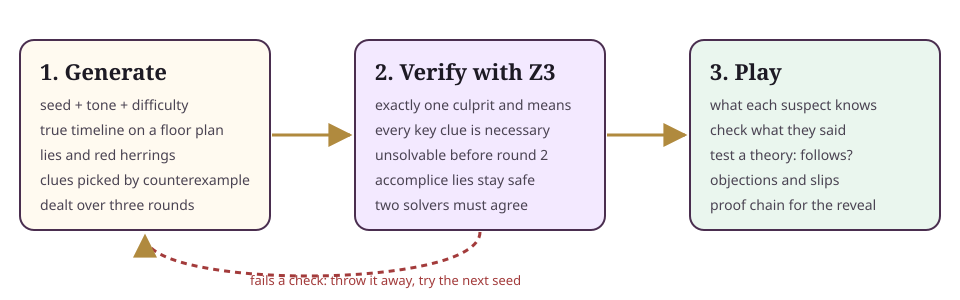

# fairplay

**Murder mysteries that a logic solver proves fair before anyone plays them.**



fairplay writes a fresh whodunit from a number: a house with a floor plan, a cast of suspects with motives and voices, a crime, where everyone really was all evening, who lies and why, and a deck of clues dealt over three rounds. Then Z3, an industrial strength SMT solver, checks the case from scratch:

- **Exactly one answer.** Only one culprit and one means fit the clues, and they are the right ones.
- **Every key clue matters.** Take away a key clue and the answer stops being unique.
- **It lasts the whole game.** It cannot be solved after round 1. It can be solved by round 3.
- **Nobody can break it.** Lies a secret accomplice may tell, and slips a suspect makes when you shout "Objection!", never wreck the puzzle.

A case that fails any check is thrown away and the next seed is tried. In practice, almost none fail.

fairplay powers *Accomplice*, a living room party game where AI suspects answer questions out loud. It is just as happy driving a puzzle site, a tabletop prop generator, a classroom logic exercise, or a benchmark for reasoning agents.

## Quick start (30 seconds)

```sh
npm install fairplay z3-solver
```

```ts
import { generateVerifiedCase, evaluateTheory, proofChain, shutdownSolver } from 'fairplay';

const { c, report } = await generateVerifiedCase({ seed: 7, tone: 'cozy', difficulty: 2 });

console.log(c.title, '\n', c.intro);
for (const clue of c.clues.filter((x) => x.round === 1)) console.log('-', clue.text);

const everyClue = c.clues.map((x) => x.id);
console.log(await evaluateTheory(c, everyClue, { culprit: c.suspects[0].id })); // 'follows' | 'possible' | 'contradicted'
console.log(proofChain(c).map((s) => `${s.says} ${s.therefore}`).join('\n'));

await shutdownSolver(); // lets Node exit
```

Or try it without installing anything into a project:

```sh
git clone https://github.com/dhirajkavuri/fairplay && cd fairplay && npm install
npx tsx examples/cli.ts 42 classic --solve      # a full case in your terminal
npm run build && npx serve .                    # then open /examples/playground/
```

Node 22 or newer. Z3 ships as WebAssembly, so there is nothing native to compile. The browser entry, `fairplay/core`, has everything except the Z3 verifier and runs anywhere.

## What you get in a case

| Field | What it is |
| --- | --- |
| `title`, `place`, `dateLine`, `intro`, `briefing` | The story, plus four to six short narrator lines for opening slides |
| `rooms` | Five to seven rooms with `x, y, w, h` on a 16 x 9 grid and the doors between them |
| `slots` | Five times of the evening, for example 8:00 pm to 10:00 pm |
| `suspects` | Name, `shortName`, role, speaking traits, motive, voice id, portrait key, and their claimed alibi |
| `items` | The means and some decoys, each with the room it is kept in |
| `crime` | Where and when it happened, what happened, and (secretly) the means |
| `clues` | Title, full `text`, a `short` card face of 12 words or fewer, round, board or private seat, and the typed `fact` behind it |
| `truth`, `lies` | The real timeline, the culprit, who held the means, and every lie with its reason |
| `confession`, `headline`, `paperName`, `clockChimes` | Reveal extras: three lines in the culprit's voice, a newspaper front page, and chimes for each round |

Two tones: **classic**, a bloodless country house whodunit (someone is found very dead and very politely so), and **cozy**, which is kid safe (the birthday cake vanished, the prize marrow was swapped for a supermarket courgette). Three settings: Ashby Hall, The Sapphire Express and Marigold Manor. Ten suspect archetypes, each with a distinct Amazon Polly voice.

## API

Everything is synchronous and deterministic except the functions that call Z3.

### `generateCase(opts): Case`

```ts
const c = generateCase({ seed: 2026, tone: 'classic', difficulty: 3, suspectCount: 5 });
```

Same options, same case, every time. `difficulty` 1 uses four suspects and fewer decoys and allows more direct clues; 3 leans on clues you must chain together (where someone was half an hour before, where the means was last seen).

### `verifyCase(c): Promise<VerifyReport>`

```ts
const report = await verifyCase(c);
// { ok: true, uniqueCulprit: true, culprit: 'butler', keyClues: ['r1b2', 'r3s0'], solvableByRound: 3, safeAccompliceLies: 3, ms: 160, notes: [] }
```

`notes` explains any failure in plain words.

### `generateVerifiedCase(opts, maxTries = 25)`

Tries `seed`, `seed + 1`, and so on until a case verifies. Returns `{ c, report, tries }`.

### `sliceFor(c, suspectId): SuspectSlice`

What one suspect knows, in plain sentences, and nothing else. Give this, and only this, to whatever plays the suspect: a language model, an actor, a friend.

```ts
sliceFor(c, 'cook');
// knows:        ['At 8:00 pm you were in the Kitchen.', 'At 8:00 pm you saw Ned in the Kitchen with you.', ...]
// mustLie:      ['If anyone asks where you were at 9:30 pm, say you were in the Dining Room. ...']
// mayNotReveal: ['Never confess. Never hint that you did it.', ...]
```

### `checkReply(c, suspectId, claims): ClaimCheck`

Feed it the location claims pulled out of what a suspect said. It flags anything false that is not that suspect's own permitted lie, anything that gives away the culprit, and claims about people the speaker never saw.

```ts
checkReply(c, 'cook', [{ kind: 'location', s: 'cook', room: 'kitchen', slot: 3 }]);
// { ok: false, violations: ['Gives away the culprit: places Mrs. Dolly Pargeter in the Kitchen at 9:30 pm.'] }
```

### `evaluateTheory(c, pinnedClueIds, theory): Promise<'follows' | 'possible' | 'contradicted'>`

Using only the clues a player has pinned: is the theory proven, still possible, or ruled out?

### `proofChain(c): ProofStep[]`

Ordered steps from clues to the answer, each naming who it rules out. Built for a dramatic reveal.

```ts
// { clueId: 'r2s0', says: 'Pippa and Rohan were together in the Galley at 8:00 pm.', therefore: '... Rohan and Pippa are in the clear.', eliminates: ['nephew', 'artist'] }
```

### `objectionSlip(c, suspectId, claims?): ObjectionResult`

A player cries "Objection!" after an answer. If that answer contained a lie, the suspect lets slip one true fact in a flustered line ("Oh, very well. At 8:30 pm I was in the Great Hall, not the Dining Room."). If not, you get an indignant retort. The culprit never confesses this way, and Z3 checks that no slip can crack the case in round 1.

### `safeLiesForAccomplice(c): AccompliceLie[]`

One to three false statements a secret accomplice may say aloud. Each is consistent with every clue, so it muddies the water without making the case unfair.

### `publicView(c): PublicCase`

The case with the solution, lies, alibis and clues removed. Safe to send to every screen.

### `describeFact(c, fact): string`

One plain sentence for a clue's underlying fact, for captions and screen readers.

### `shutdownSolver(): Promise<void>`

Stops Z3's worker threads so a script can exit.

## How the fairness proof works

Think of a case as a giant logic puzzle. The unknowns are: which room each suspect was in at each time, who did it, and with what. The rules are simple:

1. People move only through doors, one room per half hour (or they stay put).
2. The culprit was in the crime room at the crime time, holding the means.
3. Every item starts the evening where it is kept. Only the means ever moves, and only while the culprit carries it.
4. Every clue is true. A clue is a typed fact: someone *was* or *was not* somewhere, two people were *together*, an item was *in* a room, someone *had* an item.

**Building it.** The generator writes a true story first, then picks clues by argument. It asks a small built-in reasoner, "Is there any other story that fits the clues so far, with a different culprit or means?" If there is, it picks a true fact that this other story gets wrong, and adds it as a clue. It keeps going until no other story survives, then removes any clue the rest already imply. That is called counterexample guided selection, and it is why every chosen clue earns its place.

**Checking it.** `verifyCase` hands the same rules and clues to Z3 without trusting the generator. Z3 finds a story that fits, then is told "not that culprit and means" and asked again. If the answer is *impossible* (unsat), the solution is unique. It repeats this with each clue removed (key clues), with only the early rounds' clues (pacing), with each accomplice lie added, and with each objection slip added. The built-in reasoner must agree with Z3 on every answer, so a bug in one shows up as a disagreement instead of an unfair game.

**Small groups.** Key clues are only dealt to the shared board and the first three seats, so the proof holds for any table of three or more players. Extra seats get true flavour clues that never make the case solvable early.

## Benchmarks

BENCHMARKS

Reproduce with `npm run stats -- 200` (seeds 1 to N per tone, difficulty 2). CI runs 50 seeds per tone on Node 22 and 24 and uploads the numbers.

## Limitations

- Three settings, two tones, ten archetypes. Variety comes from combinations, not endless new content.
- Facts are about places and objects at fixed half hour slots. There is no reasoning yet about motives, sounds, or overlapping time.
- `checkReply` only understands location claims. Extracting claims from free speech is up to you.
- A unique answer is guaranteed for the logic. Whether players *find* it depends on how clues are presented.
- English only for now.

## Roadmap

- More settings and a content pack format, so others can ship their own houses and casts.
- New fact types: heard (sounds through walls), timestamps between slots, locked doors.
- Difficulty measured by proof length, not just by settings.
- Optional multiple culprits and team crimes, still with a unique answer.
- Translations.

## Contributing

Issues and pull requests are welcome, especially new settings and clue phrasing. See [CONTRIBUTING.md](CONTRIBUTING.md) and the [code of conduct](CODE_OF_CONDUCT.md). Found a case that looks unfair? Open an issue with the seed, tone and difficulty. That is exactly the kind of bug we most want to hear about.

## Prior art

Generating mysteries by computer is an old and lively idea. Researchers and hobbyists have built murder mystery generators, clue and alibi planners, and deduction puzzle makers for decades, using story grammars, planners, constraint solvers and answer set programming, and logic puzzles with unique solutions have been machine generated and checked for even longer. fairplay borrows freely from that tradition. What it adds is a small, practical package: a TypeScript generator tuned for spoken party play, and an SMT solver used as a referee before every game.

## Licence

MIT, copyright Dhiraj Kavuri. See [LICENSE](LICENSE).
